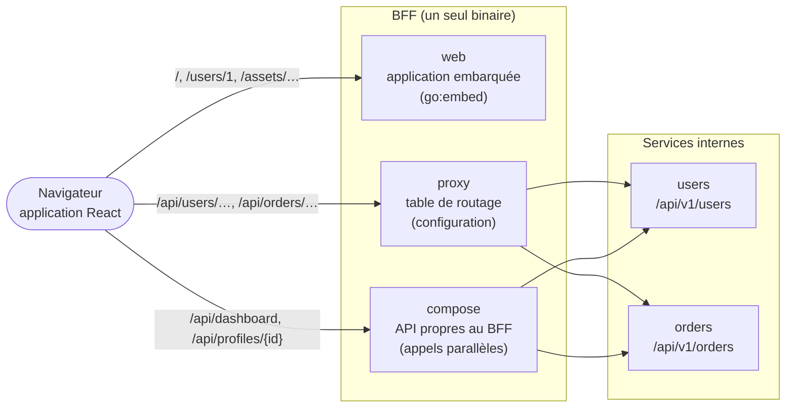

# Architecture

Le BFF (*Backend For Frontend*) est la seule porte d'entrée de l'application :
le navigateur ne parle qu'à lui, sur une seule origine (pas de CORS), et le BFF
parle aux services internes.

| Rôle | Quand l'utiliser |
|------|------------------|
| **proxy** | l'écran consomme une API telle quelle : une ligne de configuration suffit |
| **compose** | l'écran a besoin de données de plusieurs services, ou sous une autre forme : du code, dans le BFF |
| **web** | l'application elle-même, servie par le même binaire |
