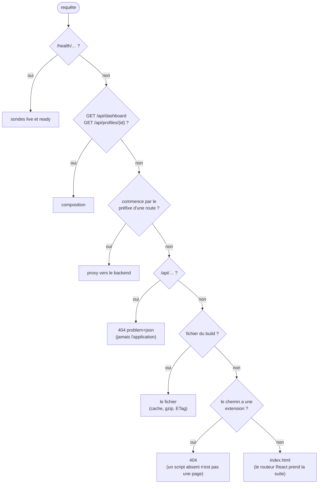

# Aiguillage d'une requête

Le routeur de la bibliothèque standard (`http.ServeMux`) choisit le motif le
plus précis : une API de composition l'emporte sur la réponse 404 de `/api/`,
qui l'emporte sur l'application.

| Chemin | Réponse | Cache |
|--------|---------|-------|
| `/`, `/users/1` | `index.html`, avec la politique de sécurité (CSP) | jamais (`no-cache`) |
| `/assets/index-3f2a1b.js` | le fichier, compressé si le client l'accepte | un an (`immutable`) : le nom porte une empreinte |
| `/api/users/42` | le backend, par le proxy | celui du backend |
| `/api/inconnu` | 404 `application/problem+json` | — |
