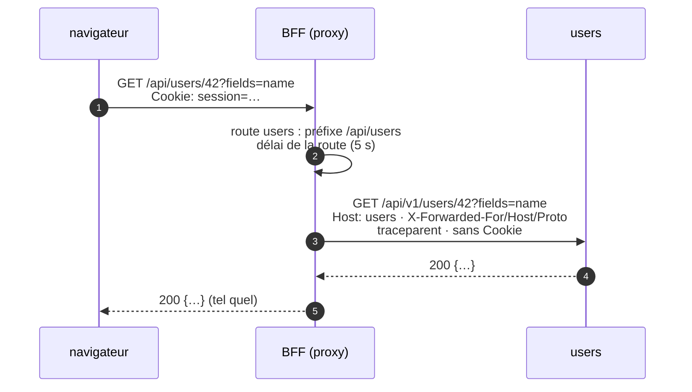

# Le proxy

| Situation | Réponse du BFF |
|-----------|----------------|
| le backend répond, même une erreur | sa réponse, telle quelle |
| le backend ne répond pas dans le délai de la route | **504** `problem+json` |
| le backend est injoignable | **502** `problem+json` |
| le corps dépasse `proxy.max_body_bytes` | **413** |
| aucune route pour ce chemin sous `/api/` | **404** |

Les messages d'erreur ne révèlent rien d'interne (adresses, erreurs réseau) :
le détail reste dans le journal du BFF. Les cookies du navigateur ne sont
jamais transmis : la session reste au BFF.
