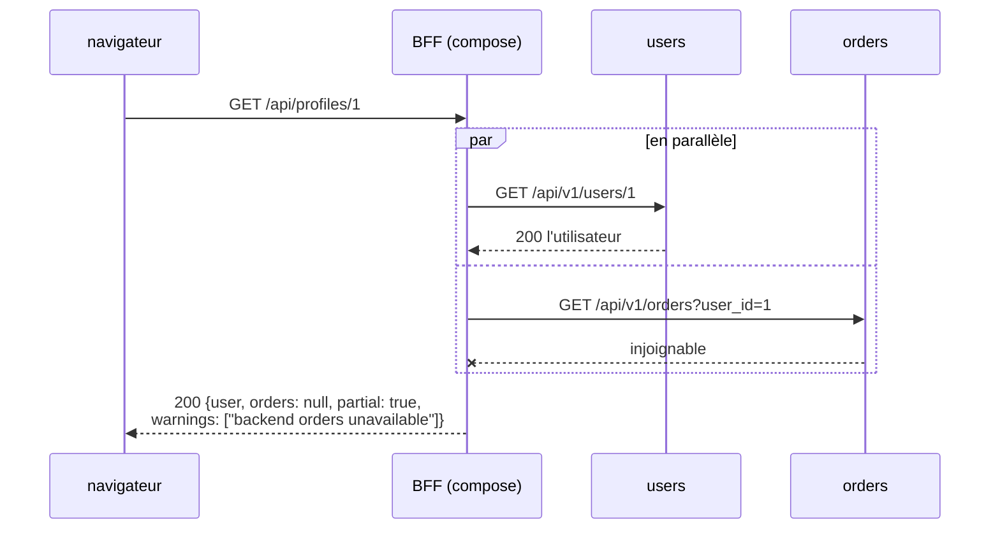

# La composition

Une API de composition appelle plusieurs services **en parallèle** : la
réponse arrive dans le délai du plus lent, et non dans leur somme. Chaque
appel garde le délai de sa route.

Deux politiques, selon ce que l'écran peut montrer :

| API | Si une source manque |
|-----|----------------------|
| `GET /api/dashboard` | **erreur** (502 ou 504) : des totaux faux seraient pires que pas de totaux |
| `GET /api/profiles/{id}` | **réponse dégradée** si les commandes manquent (`partial: true`) : le profil reste utile ; erreur si l'utilisateur manque |
