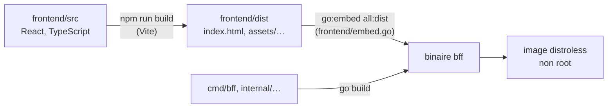
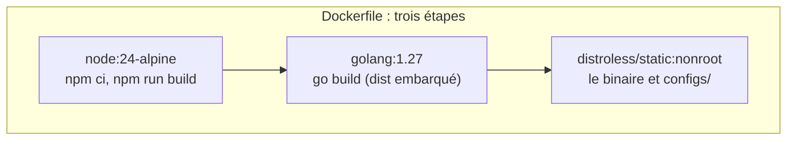

# Construire et livrer

L'application React est construite par Vite, puis **embarquée** dans le
binaire Go (`go:embed`) : un seul fichier à déployer, sans serveur web à côté.

| Commande | Effet |
|----------|-------|
| `make web` | construit `frontend/dist` (dans un conteneur Node) |
| `make build` | compile les binaires, en embarquant le dernier build |
| `make web-dev` | Vite sur :5173, rechargement à chaud, `/api` relayé vers le BFF |
| `make images` | les images du BFF et des services simulés |

Sans build, `frontend/dist/.gitkeep` permet quand même de compiler : le BFF
sert alors une page qui dit de lancer `make web`.
