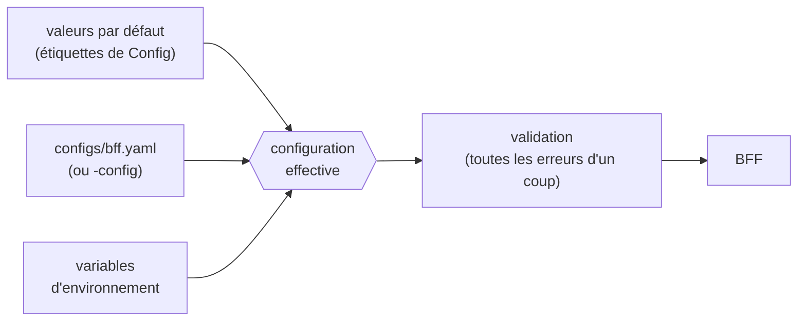

# Configuration

Chaque valeur vient, par priorité croissante, du code, du fichier YAML, puis
de l'environnement. La table de routage suit la même règle : une route se
déclare dans le fichier, ou entièrement par l'environnement.



```yaml
routes:
  users:                                       # ROUTES_USERS_…
    prefix: /api/users                         # ROUTES_USERS_PREFIX
    target: http://localhost:8091/api/v1/users # ROUTES_USERS_TARGET
    timeout: 5s                                # ROUTES_USERS_TIMEOUT (facultatif)
```

| Outil | Effet |
|-------|-------|
| `configs/reference.yaml` | toutes les clés, documentées (généré) |
| `configs/bff.env.example` | toutes les variables, valeurs de développement (généré) |
| `go run ./cmd/bff -print-config` | la configuration effective, et la source de chaque valeur |
