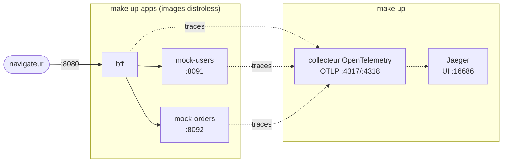

# Exécution

Une même trace suit une requête du BFF jusqu'aux services : le BFF transmet
l'en-tête `traceparent` à chaque appel (proxy comme composition).

| Commande | Effet |
|----------|-------|
| `make up` | collecteur et Jaeger, pour développer avec `make run` |
| `make mock-users`, `make mock-orders` | les services simulés (`DELAY=2s`, `FAIL=0.3`) |
| `make up-apps` | tout, depuis les images : http://localhost:8080 |
| `make down` | arrête tout |
